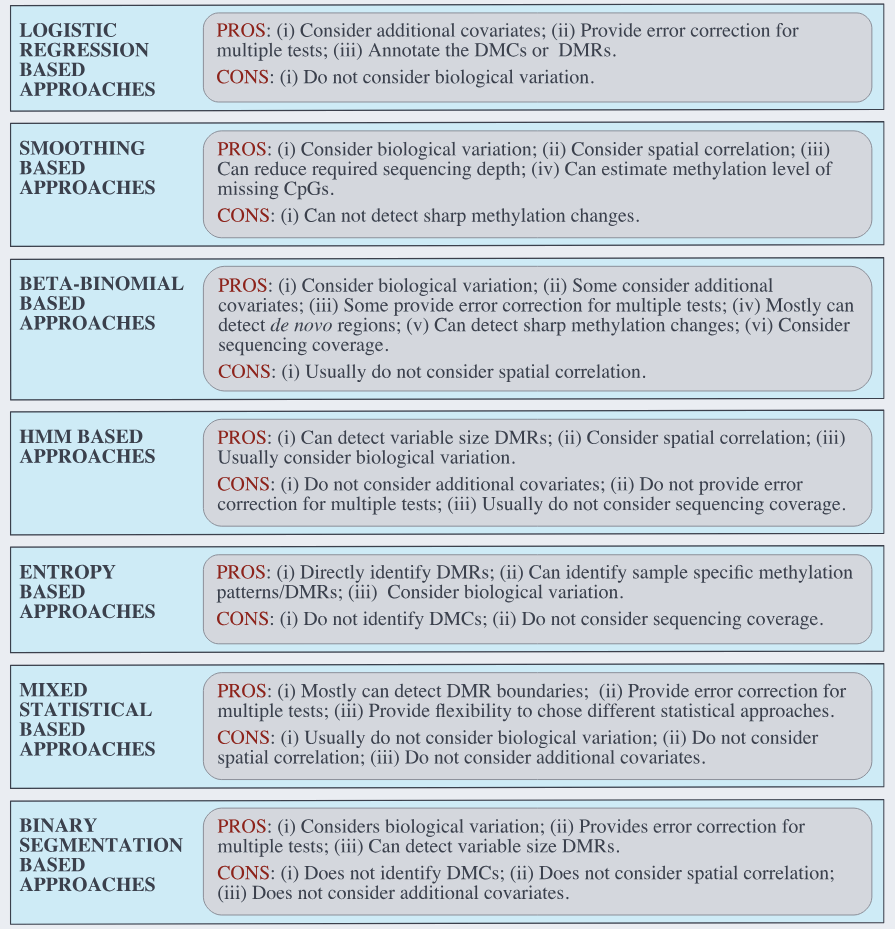
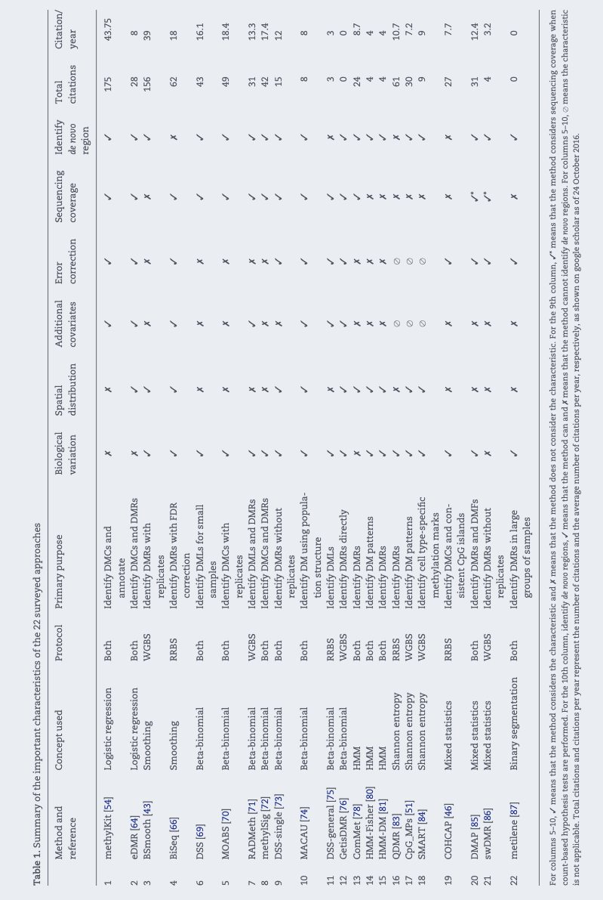

Preliminary lit review to help decide what analytical tools/approaches may be best suited to the `ceasmallr` data type and structure.

### Rondon et al. 2017

Closest comparison is probably the Rondon et al. 2017 diuron paper:

@rondon2017

METHODS:

-   Parents exposed to diuron during beginning and middle of gametogenesis, then gametes collected and used for spawning.
-   n=6 spat used for WGBS -- 3 spat from parents who experienced diuron treatment, and 3 from control parents.
-   `methylkit` for analysis: DMRs of 500bp, using minimum coverage of 10x in all reps, minimum 25% methylation difference, with FDR-adjusted pval of 0.01.
-   Used **visual inspection** to identify DMRs for which all reps were affected in same way (ngl, this seems kind of crazy to me...)
-   defined "promoter" region as 1kb upstream region.

RESULTS:

-   no treatment-based difference in global methylation level (GML), and samples did not cluster by treatment (consistent with preliminary `methylkit` work in the ceasmallr samples)

-   from 57,819 eligible windows (500bp, 10X cov), found 1,967 DMRs, with roughly even split between hyper- and hypomethylation (1,060 and 907, respectively) in treated v control samples.

::: callout-important
Rondon et al. did NOT have data from the parents. While this may be the closest comparison in the sense that they also demonstrated inheritance of treatment-induced differential methylation, they have a much smaller sample size, no parent data to try demonstrating inheritance of *parental* DMLs, and used methylKit. Should look elsewhere for a closer methodologically/experimentally similar example.
:::

### Feiner et al. 2022

@feiner2022

METHODS:

-   Daphnia (F0 generation) exposed to respective = stressors (3 natural environmetnal stressors, 1 demethylation stressor), then propogated (asexually?) through to F4.

-   WGBS for F1, F2, and F4 (note, ommited exposed parents F0, and intermediate generation F3). After `bismark` and quality filtering, n=54 libraries

-   `methylKit` – considered CpGs wiht \>=5 reads in all samples, and only variable sites with \>=0.5 std dv in % methylation – average of 2.8M sites/sample.

-   Called DMLs (they term DMPs – differentially methylated positions) using FDR-correct p=0.05 – they don't seem to have used a minimum methylation difference. These parameters are more permissive than the p\<0.01 (corrected) and \>25% methylation difference used by me, Rondon, etc.

-   Def. of treatment-induced transgenerational DML:

    -   treatment-induced differential methylation in F1

    -   methylation state maintained in F2 and F4

    -   \^ don't clarify whether this also requires maintaining *direction* of differential methylation (hyper- or hypo-).

-   some sort of permutation approach to provfide additional support for ID'd DMLs?

### Peterson et al. 2024

@peterson_mixed_2024

-   Two species – Acropora millepora and A. selago

-   No treatments

-   both pure (m1 x m2, m2 x m1, s1 x s2, s2 x s1) and hybrid (s1 x m1, s1 x m2, s2 x m1, s2 x m2) crosses

-   WGBS

-   used DSS!

-   

Ultimately I don't think this approach is very useful – I'm looking at other papers in the invertebrate DNA methylation world, and there seem to be very few or no other studies with identical experimental design (treated parents, offspring with multiple lifestages, etc.). As such, I'm not finding much insight on how to handle the most glaring challenges: pseduoreplication from shared parentage

Let's instead take a look at some methods papers. Some general googling suggests that the best approach to account for pseudoreplication when working with high-throughput sequencing data (RNAseq, WGBS, etc.) is tools that make use of Linear Mixed-effects Models (LMMs or GLMMs). There do also seem to be tools that are specifically designed to account for genetic differences in use with methylomic data (e.g., `MACAU`)

### **Shafi et al. 2017 – A survey of the approaches for identifying differential methylation using bisulfite sequencing data**

@shafi_survey_2017

#### Logistic regression-based approaches

-   `methylKit` and other logistic regression-based approaches take sequencing coverage into account, can incorporate additional covariates, and can work with CHG or CHH methylation, BUT cannot consider **biological variation** among replicates.

#### Smoothing-based approaches

-   These assume that methylation levels of the CpG sites"vary smoothly across the genome" (rather than, for example, the methylation of one site being radically different from its adjacent CpG neighbors – if I understand correctly?)

-   Application of this smoothing permits estimating methylation levels of CpG sites by borrowing info from neighbors. This reduces required sequencing coverage and permits estimation of methylation of *missing* CpG sites. HOWEVER, poorly handle regions where methylation has sharp cahnges (e.g., transcription factor binding sites, which are often \<50bp). Biological events involving a single CpG site (isolated from other sites) may not be detected.

-   `BSmooth`: first example of smoothing approach, but lacks suitable error measurements, only applicable with biological replicates, and limited to comparisons between two groups

-   `BiSeq`: smooths across candidate *regions* instead of samples. Also, smoothing method takes coverage into account, so that CpGs with higher coverage have higher impact on estimated methylation. In addition to identifying DMCs using Wald test, also uses hierarchical testing to ID significant clusters containing DMC(s), accounting for size. Provides region-wise error control measurment, can add additional covariates. However, limited to application in experiemnts with predefined regions (e.g., RRBS data)

#### Beta-binomial-based approaches

These are of particular interest to me because the category includes both `DSS`, which I've been trialing recently, *and* `MACAU`, which popped up in google searches for BS tools that can handle pseudoreplication related to shared parentage.

-   With this approach, methylation read counts are characterized as a beta-binomial distribution

::: callout-note
A **beta-binomial distribution** models the number of successes in a fixed number of trials when the probability of success varies randomly according to a beta distribution (rather than the probability of success being constant). It's commonly used to capture overdispersion (the presence of greater variability than expected) in binomial type data. ([Wikipedia](https://en.wikipedia.org/wiki/Beta-binomial_distribution))
:::

There are a whole bunch of tools reviewed here that make use of a beta-binomial-based approach (MOABS, RADMeth, methylSig, DSS-single, DSS-general, GetisDMR), but I'm going to focus on `DSS` and `MACAU` for now

-   `DSS`: Prior distribution is constructed from the whole genome, the biological variability is captured by the beta distribution, and the sampling variability is captured by the binomial distribution. This method is particularly useful when working with small sample sizes, because it makes use of a shrinkage procedure to improve estimation of the dispersion parameter under low sample sizes. There is even a version which can be applied without any biological replicates (n=1). It's also advantageous because it can be applied to data with multiple groups or covariates.

-   `MACAU`: Based on a binomial mixed model that ***takes population structure into account*** – this is why it could be useful to me for handling my data's parental pseudoreplication. This is in addition to taking biological variability among samples and sampling variability among sequencing reads into account. It can also be applied to both WGBS and RRBS data.\
    This is the only tool reviewed in this paper that can take population structure into account

I'm actually going to end my in-depth notetaking here, since the remaining types of methylation analysis tools seem to be less well-suited to the type of work I'm doing (with the exception of hidden markov based approaches, all remaining types are ratio-based, rather than count, are limited in their ability to consider additional covariates, and don't seem to be able to ID DMCs, only DMRs)

