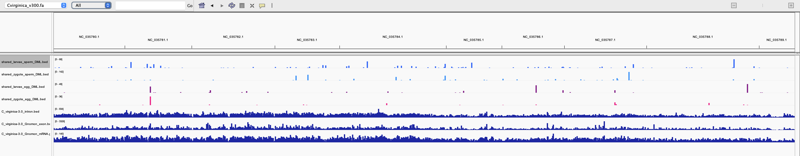
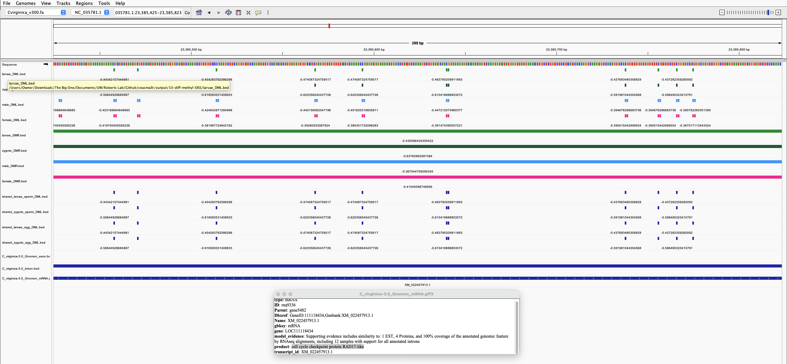

I want to start looking through the parent-offspring shared DMLs and DMRs using a genome browser, to better contextualize their relative locations, positions relative to other genomic features (introns, exons), etc.

Loaded all of the DML and DMR bed files generated in `10-diff-methyl-DSS.Rmd` and `10.1-diff-methyl-DSS-parents.Rmd` into IGV:

- `zygote_DML.bed`
- `zygote_DMR.bed`
- `larvae_DML.bed`
- `larvae_DMR.bed`
- `female_DML.bed`
- `female_DMR.bed`
- `male_DML.bed`
- `male_DMR.bed`

as well as the bed files of DMLs that are *shared* among both parents and offspring -- currently these are split by both parent sex and offspring lifestage:

- `shared_zygote_egg_DML.bed`
- `shared_zygote_sperm_DML.bed`
- `shared_larvae_egg_DML.bed`
- `shared_larvae_sperm_DML.bed`

I also loaded the *C. virginica* genome and feature tracks for mRNA, exons, and introns, all aquired from the [lab handbook page of genomic resources](https://robertslab.github.io/resources/Genomic-Resources/#crassostrea-virginica).

Some interesting things pop out!

Here's the full view with just the shared DML tracks and genome annotations

We can see the numeric trend of there being more shared DMLs with the paternal contribution (top two tracks) than the maternal (next two tracks, in pink).

I see only one location in the whole genome where all four of the shared DML tracks overlap -- in other words, where both sexes AND both lifestages have treatment-associated DMLs.

In this region, both parent sexes AND both offspring lifestages share 11 DMLs, all hypomethylated with ~45% - ~60% methylation difference, and all within a ~300bp range. These DMLs sit within an intron in the gene LOC111118434, which is annotated to encode "cell cycle protein RAD17-like". This is essential to sustained cell growth and maintenance of chromosomal stability, and is a key component for sensing DNA damage and activating ATR-dependent DNA damage response ([Uniprot](https://www.uniprot.org/uniprotkb/O75943/entry#function))

Since I know that there is little zygote-larvae overlap and little egg-sperm overlap, it will be interesting to run functional annotation and enrichment analysis on the DMLs from each group, to see where similarity/dissimilarity lies...