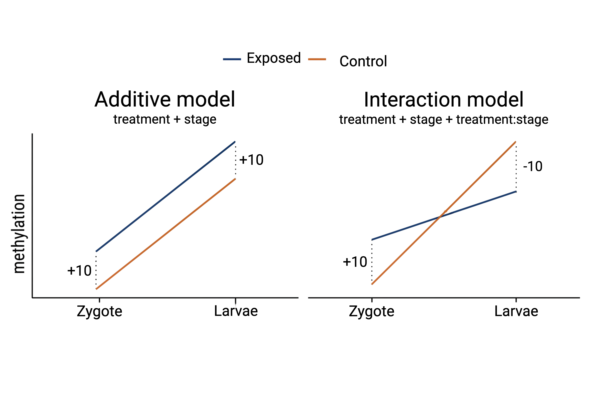

Within-stage/within-sex smoothed tests

To perform the test, use `DMLtest()`, then use `callDML()` and `callDMR()` to call DMLs and DMRs.

```{r, eval=FALSE}
run_stage <- function(stage_label) {
  s_idx  <- which(meta$stage == stage_label)
  BS_s   <- BSobj[, s_idx]
  g_exp  <- meta$sample[s_idx][meta$treatment[s_idx] == "Exposed"]
  g_ctrl <- meta$sample[s_idx][meta$treatment[s_idx] == "Control"]
  dml <- DMLtest(BS_s, group1 = g_exp, group2 = g_ctrl, smoothing = TRUE)
  out <- list(
    dml = callDML(dml, delta = 0.25, p.threshold = 0.01),
    dmr = callDMR(dml, delta = 0.10, p.threshold = 0.01,
                  minlen = 50, minCG = 3, dis.merge = 100, pct.sig = 0.5)
  )
  # write per-stage results to disk immediately, so a later crash can't lose them
  saveRDS(dml, file.path("../output/10-diff-methyl-DSS", paste0(stage_label, "_DMLtest.rds")))
  rm(dml, BS_s); gc()
  out
}
```

`DMLtest()` performs the following steps: (1) estimate mean methylation levels for all CpG site (I'm doing this with smoothing enabled); (2) estimate dispersions at each CpG sites; (3) conduct Wald test. Smoothing is recommended for use with WGBS data, because it permits information from nearby CpG sites to be combined, improving estimation of methylation levels.

For my runs of `callDML()`, I'm requiring a minimum difference in methylation level of 0.25, and a minimum adjusted-pvalue of 0.01. For `callDMR()`, which identifies regions with many statistically-significant DMLs, I require a minimum region length of 50 nucloeotides containing at least 3 CpG sites, with at least 50% of the CpGs sites being significant DMLs.

For the multifactor design tests, the primary function is `DMLfit.multifactor()`.

## How do the two models differ?

The two models I've tried are additive (`treatment + stage`, `treatment + sex`) and interaction (`treatment + stage + treatment:stage`, `treatment + sex + treatment:sex`).

Here's the general idea of how they differ (I'll be explaining through the treatment/stage case, but the same idea applies to the parental treatment/sex case).



### The additive model

The treatment effect is the same for both lifestages, though there may be a "shift" involved -- essentially, both lifestages exhibit the same slope of change, but may have different intercepts. With this model we're asking "when you pool both life stages and adjust for the stage difference (the possible intercept shift), does parental exposure affect offspring methylation?".

### The interaction model

The treatment effect *can differ* between life stages -- both slope and intercept may differ. With this model we can ask "Does the effect of parental exposure *change* from zygote to larvae?"
