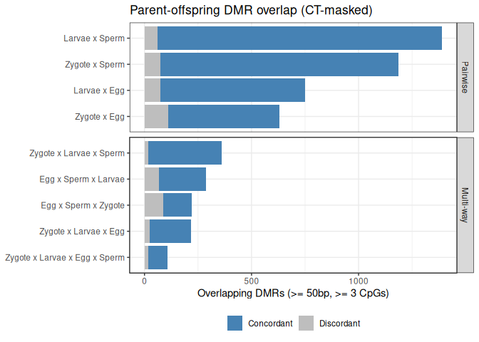
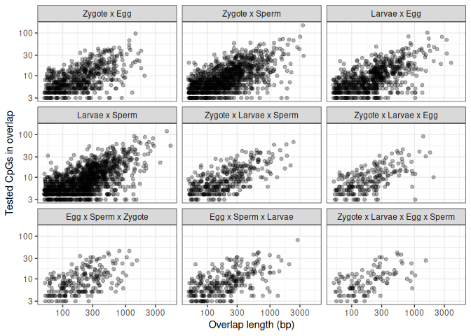

One indicator of faithfully inherited differential methylation is differentially methylated loci (DMLs) that are present in both the exposed parents (eggs and/or sperm) *and* in the offspring (zygote and larvae). I've already identified these overlapping parent/offspring DML sets in parent differential methylation analyses ([10.11-diff-methyl-DSS-parents-CTmask](https://github.com/shedurkin/ceasmallr/blob/main/code/10.11-diff-methyl-DSS-parents-CTmask.md)). However, there's evidence that differentially methylated *regions* (DMRs) or summarized gene-body methylation (gbM) are more biologically relevant (see @liew_epigenome-associated_2018, @dixon_bimodal_2014), in addition to reducing noise (the CpG aggregation increases statistical power and reduces false positives). We already found DMRs in offspring and parents during differential methylation analysis ([10.01-diff-methyl-DSS-CTmask](https://github.com/shedurkin/ceasmallr/blob/main/code/10.1-diff-methyl-DSS-parents.md), [10.11-diff-methyl-DSS-parents-CTmask](https://github.com/shedurkin/ceasmallr/blob/main/code/10.11-diff-methyl-DSS-parents-CTmask.md)). Here, I find overlaps among those DMR sets.

Since a DMR is a region, two DMRs could technically "overlap" by a single base pair, which isn't very meaningful. For now I'll define an overlap using the same criteria DSS uses to call DMRs: (`callDMR(minlen = 50, minCG = 3)`):

-   minimum overlap of **\>= 50bp**, and
-   overlap must contain **\>= 3 CpG sites**

Full code available at [13-DMR-overlap-CTmask](https://github.com/shedurkin/ceasmallr/blob/main/code/13-DMR-overlap-CTmask.md)

## Results

Summary of DMRs accross the 4 primary sets (parents -- eggs/sperm; offspring -- zygote/larvae)

| set    | n_DMRs | median_bp | pct_hyper |
|:-------|-------:|----------:|----------:|
| Zygote |   5128 |       166 |      31.3 |
| Larvae |   4590 |       211 |      53.7 |
| Egg    |  11143 |       238 |      50.0 |
| Sperm  |  18493 |       256 |      53.3 |

Counts of overlaping DMRs among different comparison sets:\

Tables:

| off_name | par_name | n_off_DMRs | n_par_DMRs | n_any_overlap | n_pass | n_pass_concord | n_off_DMRs_pass | n_par_DMRs_pass | pct_off_DMRs_shared | pct_concordant |
|:------|:------|------:|------:|------:|------:|------:|------:|------:|------:|------:|
| Zygote | Egg | 5128 | 11143 | 766 | 629 | 517 | 613 | 584 | 12.0 | 82.2 |
| **Zygote** | **Sperm** | **5128** | **18493** | **1376** | **1186** | **1111** | **1151** | **1079** | **22.4** | **93.7** |
| Larvae | Egg | 4590 | 11143 | 916 | 751 | 678 | 726 | 714 | 15.8 | 90.3 |
| Larvae | Sperm | 4590 | 18493 | 1643 | 1390 | 1329 | 1346 | 1292 | 29.3 | 95.6 |

Plotted:

As in DML overlap comparisons, almost all overlapping DMRs are directionally concordant (sign of the offspring score == sign of the parent score). Also as noticed in DML overlap comparisons, only a small portion of features are present in all parents and offspring (Zygote x Larvae x Egg x Sperm). Much of the ceasmallr data thus far has suggested that the paternal contribution has a greater influence on the offspring methylome, and this is still supported at the DMR level, with offspring x sperm comparisons having both greater counts and rates of directional concordance than offspring x egg comparisons.

If we assume primary paternal contribution and focus on the larvae stage of offspring (later in development, and thus later in any possible reprogramming timeline), we see 1186 overlapping DMRs, with 93.7% of them directionally concordant.

Again, as with DML comparisons, we see only partial overlap between the two offspring lifestages, suggesting partial epigenetic reprogramming.

The majority of overlapping DMRs are less than 1000bp long, and contain fewer than 30 tested CpGs. It may be prudent to more seriously consider the parameters that constitute an "overlap" – not sure at the moment the biological relevance of very diffuse CpGs. Maybe a length-dependent parameter (e.g., need average of at least 1 CpG per 20bp).
