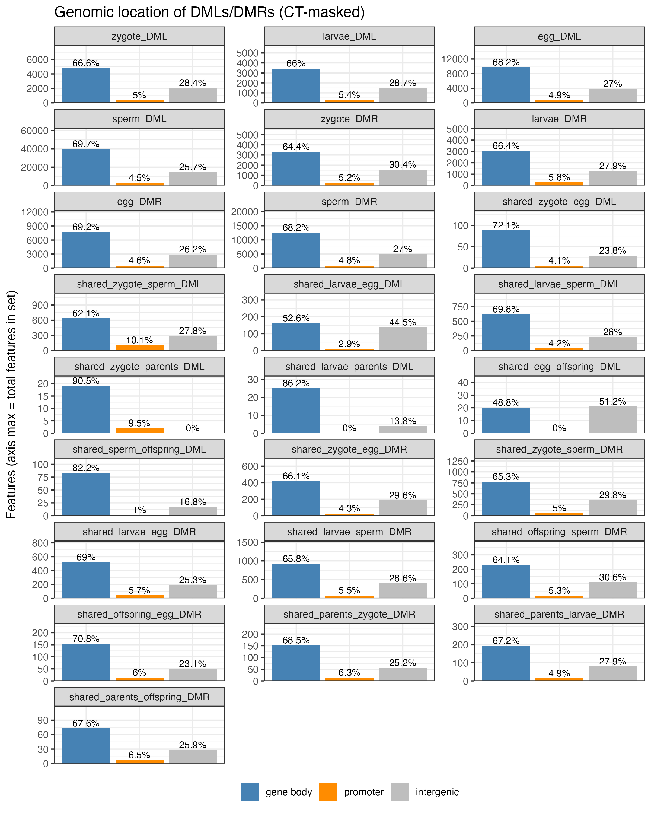
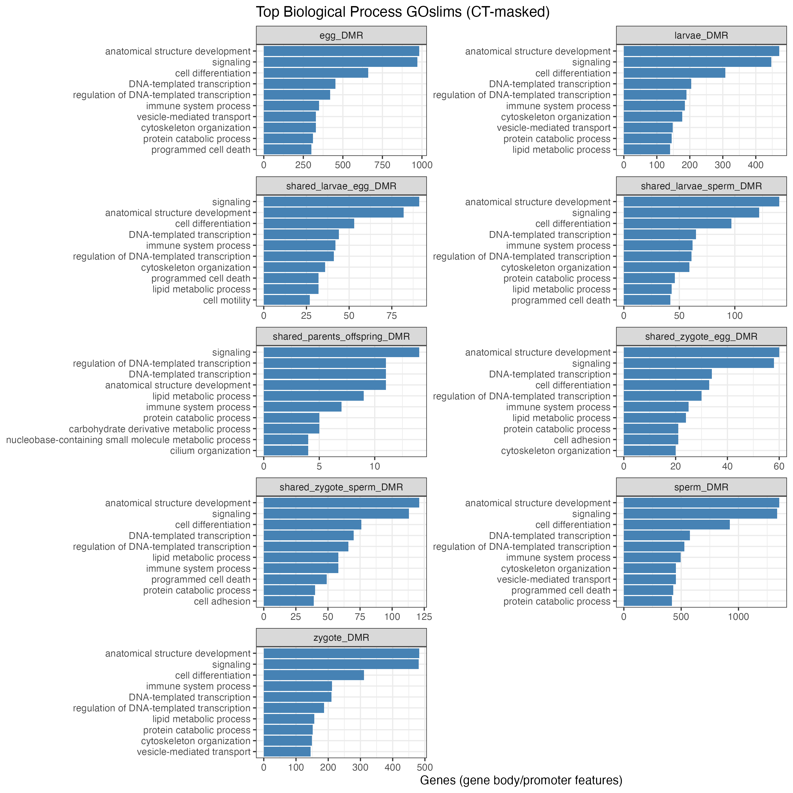

After constructing a table of functional annotations for *C. virginica* genes, I can annotate my features of interest -- parental-treatment-based differentially methylated loci (DMLs) and differentially methylated regions (DMRs).

This is essentially just a series of table joins -- full code can be found at [14.1-functional-annotation-DMLs-DMRs](https://github.com/shedurkin/ceasmallr/blob/main/code/14.1-functional-annotation-DMLs-DMRs.md)

In all sets, DMLs and DMRs primarily occur in the gene body, followed by intergenic regions. Only a small portion of DMLs/DMRs occur in promoter regions (defined as 2kb upstream of a gene). I'll need to find the files of more detailed genomic feature tracks to provide more specific genomic context trends (i.e., introns, exons, TEs)

Breakdown of most common BP categories for each DML/DMR set:

Importantly, this only describes which functions are *present* among DM features, so next steps are to ask whether any functions are *over-represented*, using an enrichment test (e.g. `topGO` or `goseq`). (Note should use all *tested* CpGs (`tested_loci.bed.gz`) as the background, rather than the whole genome, since only genes with sufficient coverage could have been called as DM)
